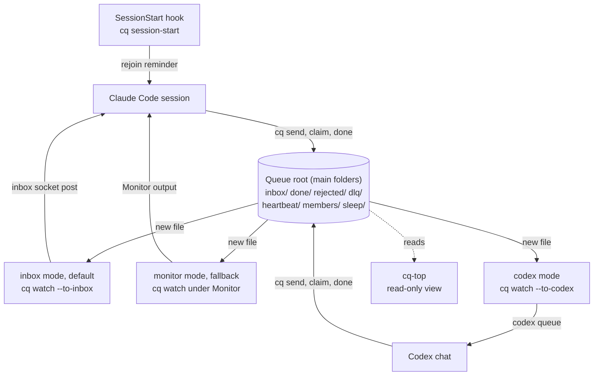

# cq: a message queue for AI coding sessions


`cq` lets AI coding sessions on one computer hand work to each other and wake each other, with nobody typing. Each message is one JSON file in a shared folder, the queue root, and a small watcher process per session wakes its session when a message arrives. A hand-off between sessions usually needs a person to pass it on; with `cq`, hand-offs continue when nobody is at the keyboard. It is for people who run several coding sessions on one project, for example a lead and two workers.

**Status:** tested on Windows 11 only. macOS compiles but has not run on a Mac ([#1](https://github.com/niklasrichardson/session-queue/issues/1)). Linux has not been built ([#2](https://github.com/niklasrichardson/session-queue/issues/2)). The cq-top Sessions screen is not yet tested on macOS ([#17](https://github.com/niklasrichardson/session-queue/issues/17)). See [Platform status](docs/OVERVIEW.md#platform-status).

## How it works



- **The `cq` CLI** does every queue action: `send`, `claim`, `done`, `list`, `sleep`, `wake`. Each action reads or writes files; messages move between folders by atomic rename. The full layout is in [Commands](docs/COMMANDS.md#layout). There is no server, database or network.
- **The watcher** (`cq watch --as NAME`) watches one inbox. Only one watcher runs per name. It prints one `CQ-NEW` line per new message. Its mode decides how that line wakes the session:

| Mode | Command | How it wakes the session |
| --- | --- | --- |
| inbox (default for Claude Code) | `cq watch --as NAME --to-inbox` | Posts the lines into the session's own Claude Code inbox. A message to an idle session starts a turn. |
| codex | `cq watch --as NAME --to-codex THREAD` | Runs `codex queue` with a fixed prompt. The Codex Desktop app starts a turn in that chat. Experimental. See [Codex setup](docs/CODEX.md). |
| monitor (fallback) | `cq watch --as NAME` under the Monitor tool | Each output line wakes the session. The Monitor expires after 30 minutes, so the session re-arms it. Use it only when `--to-inbox` exits 64 (no inbox). |

One task from start to finish, the cost of an idle session, the safety model and the platform status are in [How cq works](docs/OVERVIEW.md).

## Getting started

### Claude Code

You need Claude Code, stable Rust, and Windows with Git Bash (macOS builds, but is untested). The full steps, including the rejoin hook and the skills, are in [Setup](docs/SETUP.md).

1. Install and create the queue root:

   ```bash
   cargo install --path .
   cq init
   ```

2. Add `Bash(cq *)` to `permissions.allow` in `~/.claude/settings.json`, so unattended sessions never stop at a permission prompt. Then restart the Claude app.
3. Give each session a queue name with the start prompt in [`CLAUDE-snippets.md`](CLAUDE-snippets.md#3-session-start-prompt). It starts one watcher as a background Bash command:

   ```bash
   cq watch --as worker-a --to-inbox 2>&1
   ```

4. Send a task from another session:

   ```bash
   cq send --from lead --to worker-a --type task <<'EOF'
   {"subject": "Run the tests", "body": "Run cargo test and report failures."}
   EOF
   ```

### Codex

You need the Codex Desktop app or the interactive Codex CLI, a Codex CLI with `codex queue`, and stable Rust. Codex was tested on Windows only. The full steps, and the `cq dispatch` worker for a fresh Codex run per task, are in [Codex setup](docs/CODEX.md).

1. Choose one absolute queue root, or keep the per-user default. If you choose your own, set it as `CQ_ROOT` before the next step, and use the same `CQ_ROOT` for every `cq` command: in the chat, for the watcher and for the sender.
2. Install `cq` and run `cq init`, as in step 1 of the Claude Code steps. The tested setup called `cq` and `codex` by their full paths, for example `C:/full/path/to/cq.exe`. If you use the bare names, check that `cq --version` works in a new Codex chat.
3. Give the chat its rules: the queue rules block and a section for its queue name in `AGENTS.md`. See [Give the chat its rules](docs/CODEX.md#give-the-chat-its-rules). Let the chat write to the queue root ([Allow `cq` without prompts](docs/CODEX.md#allow-cq-without-prompts)). A setup where Codex never asks for approval is not tested yet.
4. Start the watcher in the background, outside the chat, with the same `CQ_ROOT`. In the chat, `CODEX_THREAD_ID` holds the thread ID:

   ```bash
   cq watch --as worker-a --to-codex THREAD_ID
   ```

5. Send `worker-a` a test message, as in step 4 of the Claude Code steps. Expected result: the watcher prints one `queued a check` line, and the chat starts a turn within seconds.

Every session must use the same absolute queue root (`CQ_ROOT`, or the per-user default in [Configuration](docs/SETUP.md#configuration)). For other agents, see [Other agents](docs/SETUP.md#other-agents).

## Documentation

| Document | What it covers |
| --- | --- |
| [How cq works](docs/OVERVIEW.md) | Why `cq` exists, one task from start to finish, idle cost, safety model, platform status |
| [Setup](docs/SETUP.md) | Requirements, install steps, configuration, skills, other agents, upgrading |
| [Queue rules](docs/QUEUE-RULES.md) | Rules to paste into any agent's instruction file |
| [`CLAUDE-snippets.md`](CLAUDE-snippets.md) | Claude Code blocks and session prompts to paste |
| [Codex setup](docs/CODEX.md) | Setting up and waking a Codex chat, the `cq dispatch` worker, recovery |
| [Session protocol](docs/PROTOCOL.md) | How a session watches, claims, replies, rejoins and sleeps; storm limits |
| [Example session rules](docs/SESSION-RULES.example.md) | A longer rules file to adapt, with a part for each agent |
| [Commands](docs/COMMANDS.md) | Every command, the exit codes, the queue root layout |
| [cq-top](docs/CQ-TOP.md) | The live, read-only terminal view of the queue |
| [Design decisions](docs/DESIGN.md) | Why `cq` behaves as it does, and known risks |
| [Test status](docs/TESTING.md) | What has been tested live, and what has not |
| [Specification](docs/SPEC.md) | The original requirements, architecture and test plan |
| [`CONTRIBUTING.md`](CONTRIBUTING.md) | How to report a problem, build, test and send a pull request |
| [`AGENTS.md`](AGENTS.md) | Rules for AI agents that change this repo |

## Contributing

Issues and pull requests are welcome. Testing on macOS and Linux is the most useful help right now. See [CONTRIBUTING.md](CONTRIBUTING.md).

## Licence

MIT. See [`LICENSE`](LICENSE).
