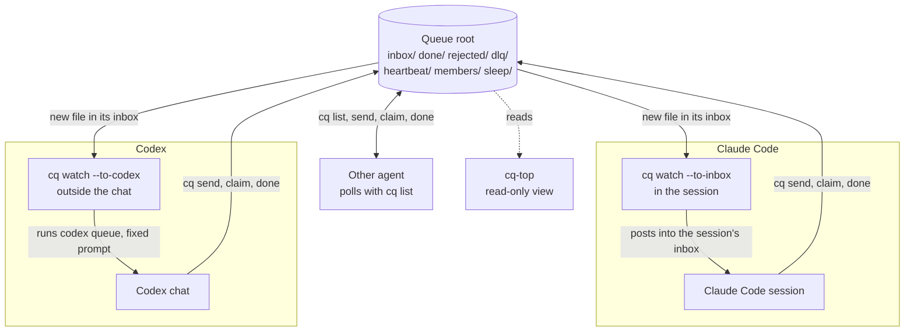

# cq: a message queue for AI coding sessions


`cq` lets AI coding sessions on one computer hand work to each other and wake each other, with nobody typing. Each message is one JSON file in a shared folder, the queue root, and a small watcher process per session wakes its session when a message arrives. A hand-off between sessions usually needs a person to pass it on; with `cq`, hand-offs continue when nobody is at the keyboard. It is for people who run several coding sessions on one project, for example a lead and two workers.

**Status:** tested on Windows 11 only. macOS compiles but has not run on a Mac ([#1](https://github.com/niklasrichardson/session-queue/issues/1)). Linux has not been built ([#2](https://github.com/niklasrichardson/session-queue/issues/2)). The cq-top Sessions screen is not yet tested on macOS ([#17](https://github.com/niklasrichardson/session-queue/issues/17)). See [Platform status](docs/OVERVIEW.md#platform-status).

## How it works



Either agent can send a task to the other. The receiving agent's own watcher wakes it, and the reply wakes the sender the same way. Only Claude Code and Codex have been tested.

- **The `cq` CLI** does every queue action: `send`, `claim`, `done`, `list`, `sleep`, `wake`. Each action reads or writes files; messages move between folders by atomic rename. The full layout is in [Commands](docs/COMMANDS.md#layout). There is no server, database or network.
- **The watcher** (`cq watch --as NAME`) watches one inbox. Only one watcher runs per name. Each agent has its own way to be woken:

| | Claude Code | Codex |
| --- | --- | --- |
| Default wake | `cq watch --as NAME --to-inbox`, started in the session as a background Bash command. It posts the lines into the session's own Claude Code inbox. A message to an idle session starts a turn. | `cq watch --as NAME --to-codex THREAD`, started outside the chat. It runs `codex queue` with a fixed prompt. The Codex app starts a turn in that chat. |
| Fallback | Monitor mode: `cq watch --as NAME` under the Monitor tool. It expires after 30 minutes, so the session re-arms it. Only when `--to-inbox` exits 64 (no inbox). | Same-chat scheduled automation in the Codex app. Each run costs a model turn, even with an empty inbox. Only when `codex queue` is not available. |
| Fresh run per task | Not available | `cq dispatch` runs `codex exec` once per task. |
| Setup | [Claude Code setup](docs/CLAUDE-CODE.md) | [Codex setup](docs/CODEX.md) |

`cq --help` marks both `--to-inbox` and `--to-codex` as experimental. Any other agent needs a wake route of its own: see [Other agents](docs/OTHER-AGENTS.md). One task from start to finish, what each agent supports, the cost of an idle session, the safety model and the platform status are in [How cq works](docs/OVERVIEW.md).

## Getting started

You need stable Rust, Windows (macOS builds, but is untested) and an agent that can run shell commands. The full steps are in [Setup](docs/SETUP.md).

### 1. Install

```bash
cargo install --path .
cq init
```

Every session must use the same absolute queue root: `CQ_ROOT`, or the per-user default in [Configuration](docs/SETUP.md#configuration). If you set `CQ_ROOT`, set it before you run `cq init`, and use the same value for every `cq` command.

### 2. Connect each session

Give each session its own queue name, such as `worker-a`, and the [queue rules](docs/QUEUE-RULES.md), which are the same for every agent. The rest differs per agent.

#### Claude Code

On Windows, you also need Git for Windows. The full steps, including the rejoin hook and the skills, are in [Claude Code setup](docs/CLAUDE-CODE.md).

1. Add `Bash(cq *)` to `permissions.allow` in `~/.claude/settings.json`, so unattended sessions never stop at a permission prompt. Then restart the Claude app.
2. Add the queue rules and the Claude Code block from [`CLAUDE-snippets.md`](CLAUDE-snippets.md#1-user-level-block) to `~/.claude/CLAUDE.md`.
3. Give the session its queue name with the [start prompt](CLAUDE-snippets.md#3-session-start-prompt). It starts one watcher as a background Bash command:

   ```bash
   cq watch --as worker-a --to-inbox 2>&1
   ```

#### Codex

You also need the Codex Desktop app or the interactive Codex CLI, and a Codex CLI with `codex queue`. Codex was tested on Windows only. The full steps, and the `cq dispatch` worker for a fresh Codex run per task, are in [Codex setup](docs/CODEX.md).

1. The tested setup called `cq` and `codex` by their full paths, for example `C:/full/path/to/cq.exe`. If you use the bare names, check that `cq --version` works in a new Codex chat.
2. Give the chat its rules: the queue rules block and a section for its queue name in `AGENTS.md`. See [Give the chat its rules](docs/CODEX.md#give-the-chat-its-rules).
3. Let the chat write to the queue root ([Allow `cq` without prompts](docs/CODEX.md#allow-cq-without-prompts)). A setup where Codex never asks for approval is not tested yet.
4. Start the watcher in the background, outside the chat, with the same `CQ_ROOT`. In the chat, `CODEX_THREAD_ID` holds the thread ID:

   ```bash
   cq watch --as worker-a --to-codex THREAD_ID
   ```

#### Other agents

Not tested. The agent needs shell access to run `cq`, the queue rules in its instruction file, and a wake route: a wake feature, a fresh run per task, or polling with `cq list`. See [Other agents](docs/OTHER-AGENTS.md).

### 3. Send a test task

From another session:

```bash
cq send --from lead --to worker-a --type task <<'EOF'
{"subject": "Run the tests", "body": "Run cargo test and report failures."}
EOF
```

Expected result: `worker-a` starts a turn within seconds. A Claude Code session gets a message from `cq` with a `CQ-NEW` line. A Codex watcher prints one `queued a check` line, and the chat starts a turn. An agent that polls handles the task at its next run.

## Documentation

| Document | What it covers |
| --- | --- |
| [How cq works](docs/OVERVIEW.md) | Why `cq` exists, one task from start to finish, agent support, idle cost, safety model, platform status |
| [Setup](docs/SETUP.md) | The shared steps for every agent: requirements, install, the test message, configuration, sleep and wake, upgrading |
| [Claude Code setup](docs/CLAUDE-CODE.md) | What differs for Claude Code: rules, permissions, the inbox watcher, the rejoin hook, the skills, Monitor mode |
| [Codex setup](docs/CODEX.md) | What differs for Codex: rules, approvals, the `--to-codex` watcher, restart, the `cq dispatch` worker |
| [Other agents](docs/OTHER-AGENTS.md) | What any other agent or script needs: rules, permissions, a wake route |
| [Queue rules](docs/QUEUE-RULES.md) | Rules to paste into any agent's instruction file |
| [`CLAUDE-snippets.md`](CLAUDE-snippets.md) | Claude Code blocks and session prompts to paste |
| [Session protocol](docs/PROTOCOL.md) | How a session watches, claims, replies, rejoins and sleeps; storm limits |
| [Example session rules](docs/SESSION-RULES.example.md) | A longer rules file to adapt, with a part for each agent |
| [Commands](docs/COMMANDS.md) | Every command, the exit codes, the queue root layout |
| [cq-top](docs/CQ-TOP.md) | The live, read-only terminal view of the queue |
| [Design decisions](docs/DESIGN.md) | Why `cq` behaves as it does, and known risks |
| [Test status](docs/TESTING.md) | What has been tested live, and what has not |
| [Specification](docs/SPEC.md) | The original requirements, architecture and test plan |
| [`CONTRIBUTING.md`](CONTRIBUTING.md) | How to report a problem, build, test and send a pull request |
| [`AGENTS.md`](AGENTS.md) | Rules for AI agents that change this repo |

## Contributing

Issues and pull requests are welcome. Testing on macOS and Linux is the most useful help right now. See [CONTRIBUTING.md](CONTRIBUTING.md).

## Licence

MIT. See [`LICENSE`](LICENSE).
