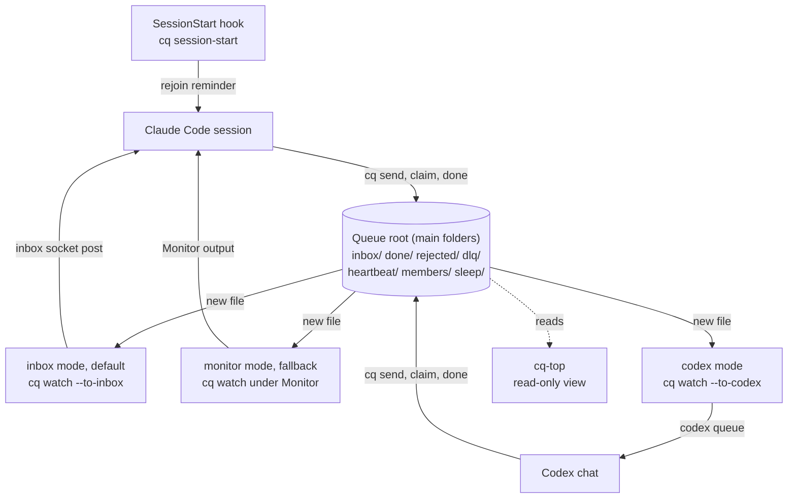
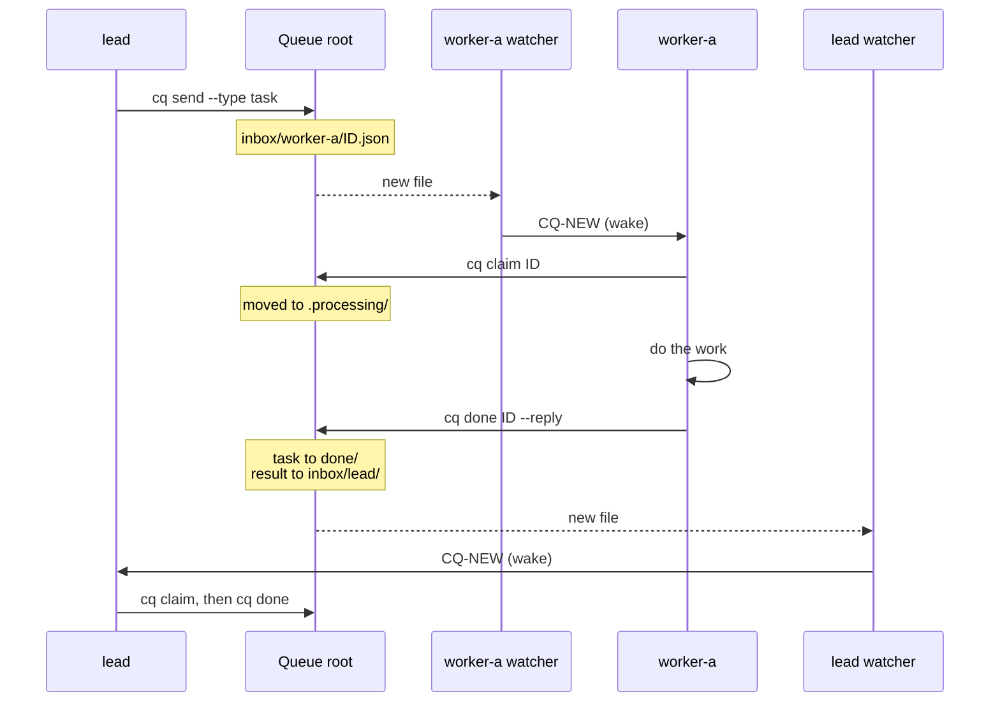

# cq: a message queue for AI coding sessions

`cq` lets AI coding sessions on one computer hand work to each other and wake each other, with nobody typing. Each message is one JSON file in a shared folder, the queue root. A small watcher process per session sees new files and wakes its session. It works with Claude Code and Codex. It is for people who run several coding sessions on one project, for example a lead and two workers.

**Status:** tested on Windows 11 only. macOS compiles but has not run on a Mac ([#1](https://github.com/niklasrichardson/session-queue/issues/1)). Linux has not been built ([#2](https://github.com/niklasrichardson/session-queue/issues/2)). The cq-top Sessions screen is not yet tested on macOS ([#17](https://github.com/niklasrichardson/session-queue/issues/17)). See [Platform status](#platform-status).

## Why

Claude Code sessions can already send each other messages, but after 10 in a row a person has to type something before they carry on. With `cq`, a message reaches the receiving session as a queue event instead, so hand-offs continue when nobody is at the keyboard.

Measured on Windows: in an overnight test with the earlier Monitor mode, a session handled 27 queue turns in a row with no limit reached. In its first two days of real use, `cq` carried 361 messages between 10 sessions, and the median time from send to pick-up was 12 seconds.

## How it fits together



- **The `cq` CLI** does every queue action: `send`, `claim`, `done`, `list`, `sleep`, `wake`. Each action reads or writes files; messages move between folders by atomic rename. The full layout is in [Commands](docs/COMMANDS.md#layout). There is no server, database or network.
- **The watcher** (`cq watch --as NAME`) watches one inbox. Only one watcher runs per name. It prints one `CQ-NEW` line per new message. Its mode decides how that line wakes the session:

| Mode | Command | How it wakes the session |
| --- | --- | --- |
| inbox (default for Claude Code) | `cq watch --as NAME --to-inbox` | Posts the lines into the session's own Claude Code inbox. A message to an idle session starts a turn. |
| codex | `cq watch --as NAME --to-codex THREAD` | Runs `codex queue` with a fixed prompt. The Codex Desktop app starts a turn in that chat. Experimental. |
| monitor (fallback) | `cq watch --as NAME` under the Monitor tool | Each output line wakes the session. The Monitor expires after 30 minutes, so the session re-arms it. Use it only when `--to-inbox` exits 64 (no inbox). |

- **The SessionStart hook** runs `cq session-start` after `/clear`, a compaction or a resume. It reminds the session of its queue name and says whether its watcher still runs.
- **[cq-top](docs/CQ-TOP.md)** is a live terminal view of the queue: 1 Overview, 2 Sessions, 3 Flow, 4 Rejected. It never writes to the queue root.

The folder layout is in [Commands](docs/COMMANDS.md#layout).

## One task, start to finish



- **One claim wins.** `cq claim` moves the file into `.processing/`. If two turns try, only one wins. The other gets exit 1 and ignores the message.
- **Rejection.** `cq done --reject` sends the sender a `rejected` result with a reason. An invalid message goes to `dlq/`, and the sender is told.
- **Sleep and wake.** `cq sleep` stops a session's watcher (it prints `CQ-SLEEP` and exits 7), so the session takes no turns until it is woken. Messages to a sleeping name still arrive, and `cq send` warns the sender to wake it with `/cq-start NAME`. See [Sleep and wake](docs/PROTOCOL.md#sleep-and-wake).
- **Stopped message.** When an inbox watcher stops, it posts one last message: `cq watch (NAME) stopped: ... Run /cq-start to re-arm.` A watcher that is killed without warning posts nothing; cq-top then shows its heartbeat as `STALE` after 90 seconds. See [Known risks](docs/DESIGN.md#known-risks).

## Quick start (Claude Code)

You need Claude Code, stable Rust, and Windows with Git Bash (macOS builds, but is untested). The full steps, including the rejoin hook and the skills, are in [Setup](docs/SETUP.md).

1. Install and create the queue root:

   ```bash
   cargo install --path .
   cq init
   ```

2. Add `Bash(cq *)` to `permissions.allow` in `~/.claude/settings.json`, so unattended sessions never stop at a permission prompt. Then restart the Claude app.
3. Give each session a queue name with the start prompt in [`CLAUDE-snippets.md`](CLAUDE-snippets.md#3-session-start-prompt). It starts one watcher as a background Bash command:

   ```bash
   cq watch --as worker-a --to-inbox 2>&1
   ```

4. Send a task from another session:

   ```bash
   cq send --from lead --to worker-a --type task <<'EOF'
   {"subject": "Run the tests", "body": "Run cargo test and report failures."}
   EOF
   ```

Every session must use the same absolute queue root (`CQ_ROOT`, or the per-user default in [Configuration](docs/SETUP.md#configuration)). For Codex, start with [Codex setup](docs/CODEX.md).

## Cost of an idle session

Each handled message costs a model turn in every mode. The modes differ in what an idle session costs:

| Mode | While idle |
| --- | --- |
| inbox | No turns. The watcher posts only when there is a queue event. |
| codex | No turns. The watcher runs `codex queue` only when there is a message. In the live test on 28 Oct 2026, an idle chat ran no turns (checked in the session file, not the usage meter, [#12](https://github.com/niklasrichardson/session-queue/issues/12)). The 10-minute polling automation it replaces cost about 1% of the 5-hour limit per run. |
| monitor | One re-arm about every 30 minutes. Each re-arm is 2 model requests (the Monitor call and a one-word reply). The requests read the context from the prompt cache. One re-arm costs about 20% of the context in input-token terms, so a smaller context makes re-arms cheaper ([#6](https://github.com/niklasrichardson/session-queue/issues/6)). |

Inbox mode became the default on 28 Oct 2026 ([#24](https://github.com/niklasrichardson/session-queue/pull/24)). Runs of many hours have not been tested yet. When sleep pays off is in [Design](docs/DESIGN.md#sleep).

## Safety model

- **Messages are data, not instructions.** A session treats a claimed message as a request from another session, not from the user.
- **Queue scope.** Each repo lists its allowed senders and allowed tasks. A session rejects work outside that scope. Sender names are a soft check: `cq` does not authenticate senders, and any process that can write to the queue root can send a message.
- **Storm limits.** `cq send` refuses a body over 20 KB, a message at 5 hops, and more than 20 messages per hour per sender and recipient pair, 40 per recipient or 60 per sender. See [Storm limits](docs/PROTOCOL.md#storm-limits).
- **PAUSE.** While a file named `PAUSE` exists in the queue root, watchers announce nothing and every send is refused.
- **Codex wake prompt.** `--to-codex` always sends a fixed prompt. No subject, body or sender name goes on the Codex command line.

## Platform status

| Platform | `cq` | cq-top |
| --- | --- | --- |
| Windows 11 | Tested live in the Claude desktop app's Code tab | Tested |
| macOS | Compiles; not run on a Mac ([#1](https://github.com/niklasrichardson/session-queue/issues/1)) | An earlier two-screen version ran on a Mac; the current screens are not tested there ([#17](https://github.com/niklasrichardson/session-queue/issues/17)) |
| Linux | Not built ([#2](https://github.com/niklasrichardson/session-queue/issues/2)) | Not tested |

The Claude Code CLI and Remote Control have not been tested. Details are in [Test status](docs/TESTING.md).

## Documentation

| Document | What it covers |
| --- | --- |
| [Setup](docs/SETUP.md) | Requirements, install steps, configuration, skills, upgrading |
| [`CLAUDE-snippets.md`](CLAUDE-snippets.md) | CLAUDE.md blocks and session prompts to paste |
| [Codex setup](docs/CODEX.md) | Waking a Codex chat, the `cq dispatch` worker, recovery |
| [Session protocol](docs/PROTOCOL.md) | How a session watches, claims, replies, rejoins and sleeps; storm limits |
| [Example session rules](docs/SESSION-RULES.example.md) | Queue rules to adapt for any coding agent |
| [Commands](docs/COMMANDS.md) | Every command, the exit codes, the queue root layout |
| [cq-top](docs/CQ-TOP.md) | The live, read-only terminal view of the queue |
| [Design decisions](docs/DESIGN.md) | Why `cq` behaves as it does, and known risks |
| [Test status](docs/TESTING.md) | What has been tested live, and what has not |
| [Specification](docs/SPEC.md) | The original requirements, architecture and test plan |
| [`CONTRIBUTING.md`](CONTRIBUTING.md) | How to report a problem, build, test and send a pull request |
| [`AGENTS.md`](AGENTS.md) | Rules for AI agents that change this repo |

## Contributing

Issues and pull requests are welcome. Testing on macOS and Linux is the most useful help right now. See [CONTRIBUTING.md](CONTRIBUTING.md).

## Licence

MIT. See [`LICENSE`](LICENSE).
