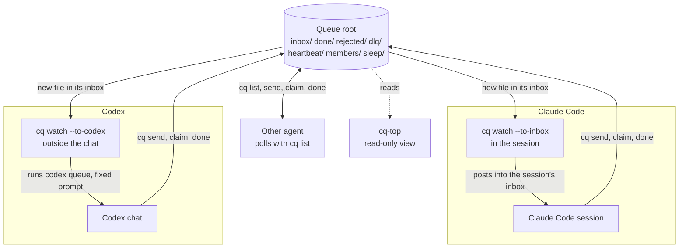

# cq: a message queue for AI coding sessions


-lightgrey)
[-green)](#support-by-agent-and-surface)

`cq` lets AI coding sessions on one computer hand work to each other and wake each other, with nobody typing. Each message is one JSON file in a shared folder, the queue root, and a small watcher process per session wakes its session when a message arrives. A hand-off between sessions usually needs a person to pass it on; with `cq`, hand-offs continue when nobody is at the keyboard. It is for people who run several coding sessions on one project, for example a lead and two workers.

The name `cq` is short for Claude/Codex queue: it began as a queue between Claude Code sessions, and Codex sessions joined later.

**Status:** tested live on Windows 11. macOS is partly tested: the build, most automated tests and inbox mode in one Claude Code session passed on a Mac, the dispatcher tests fail intermittently, and Codex and live hand-offs between sessions are not checked there ([#1](https://github.com/niklasrichardson/session-queue/issues/1)). Linux has not been built ([#2](https://github.com/niklasrichardson/session-queue/issues/2)). The cq-top Sessions screen is not yet tested on macOS ([#17](https://github.com/niklasrichardson/session-queue/issues/17)). See [Platform status](docs/OVERVIEW.md#platform-status).

## Goals

1. **Hand-offs without a person.** Sessions hand work to each other without a person prompting them.
2. **No idle checks.** No model turns are spent checking an empty queue. Monitor mode and scheduled polling are the exceptions.
3. **Quick pick-up.** A message is read soon after it is sent.

The reasons, and what each goal costs, are in [Design: Goals](docs/DESIGN.md#goals).

## How it works



Any session can send a task to another. The receiving session's own watcher wakes it, and the reply wakes the sender the same way. What has been tested with each agent is in [Support by agent and surface](#support-by-agent-and-surface).

- **The `cq` CLI** does every queue action: `send`, `claim`, `done`, `list`, `sleep`, `wake`. Each action reads or writes files; messages move between folders by atomic rename. The full layout is in [Commands](docs/COMMANDS.md#layout). There is no server, database or network.
- **The watcher** (`cq watch --as NAME`) watches one inbox. Only one watcher runs per name. Each agent has its own way to be woken (see [Support by agent and surface](#support-by-agent-and-surface)).

Any other agent needs a wake route of its own: see [Other agents](docs/OTHER-AGENTS.md). One task from start to finish, the cost of an idle session, the safety model and the platform status are in [How cq works](docs/OVERVIEW.md).

## Support by agent and surface

Each status links to its dated evidence in [Test status](docs/TESTING.md). "Not measured" means that no test recorded that delay.

| Agent or surface | Live-test status | How it learns of a message (cq mode) | Model turns while idle | Observed send-to-claim delay | Setup doc |
| --- | --- | --- | --- | --- | --- |
| Claude Code desktop app | Live: woke and handled tasks ([evidence](docs/TESTING.md#not-verified)). Unattended overnight in Monitor mode ([Why](docs/OVERVIEW.md#why)) | The inbox watcher posts into the session (`inbox`). Fallback: the Monitor tool (`mon`) | None in inbox mode. Monitor mode: 2 requests per re-arm, about every 30 minutes | Not measured | [Claude Code setup](docs/CLAUDE-CODE.md) |
| Claude Code CLI | Live, one bounded run: 25 of 25 tasks with nobody typing, in inbox mode ([evidence](docs/TESTING.md#not-verified)) | The inbox watcher (`inbox`), as in the desktop app | None in inbox mode | Not measured | [Claude Code CLI](docs/CLAUDE-CODE.md#claude-code-cli-start-with-a-stable-key) |
| Codex desktop app | Live: woke and handled messages ([evidence](docs/TESTING.md#codex-wake-on-windows-28-october-2026)). Unattended with no approval prompts: not tested | A watcher outside the chat runs `codex queue` (`codex`). Fallback: a scheduled automation in the chat | None with `--to-codex` (checked once, in the session file). Automation: 1 turn per run | About 6 s (2 chats) | [Codex setup](docs/CODEX.md#set-up-a-codex-chat) |
| Codex CLI | Live: woke and handled messages, also after 50 minutes idle ([evidence](docs/TESTING.md#codex-cli-with-the-native-watcher-on-windows-3-and-6-november-2026)). Unattended with no approval prompts: not tested | A watcher outside the chat runs `codex queue` (`codex`). The chat must be open | None by design; not checked for the CLI | Not measured | [Codex setup](docs/CODEX.md#set-up-a-codex-chat) |
| Codex via `cq dispatch` | Tests with a fake Codex, and one real read-only task ([evidence](docs/TESTING.md#codex-on-windows-26-october-2026)). Write tasks: not tested | `cq dispatch` scans the inbox every second and runs a fresh `codex exec` per task | None by design: it runs Codex only for a task | Not measured | [Dispatch worker](docs/CODEX.md#dispatch-worker-prerequisites) |
| Antigravity CLI | Experimental. Live, one short use: woke a conversation, which claimed and finished 2 messages ([evidence](docs/TESTING.md#antigravity-cli-live-use-on-windows-6-november-2026)). Long run: not tested | A watcher outside the conversation runs one print-mode `agy` turn per batch (`agy`) | None by design: `agy` runs only when a message arrives | Not measured | [Antigravity CLI setup](docs/ANTIGRAVITY.md) |
| Antigravity desktop app | Not tested ([evidence](docs/TESTING.md#antigravity-cli-live-use-on-windows-6-november-2026)) | Unknown | Unknown | Not measured | None |
| Other agents or scripts | Not tested | Needs a wake feature (a new watcher mode), a fresh run per task, or polling with `cq list` | Depends on the route. Polling costs a turn per run (seen with Codex) | Not measured | [Other agents](docs/OTHER-AGENTS.md) |

Notes:

- **Platform.** Every live test in the table ran on Windows 11. On macOS, only inbox mode in one Claude Code desktop session was checked live ([evidence](docs/TESTING.md#macos-29-october-2026)). `cq --help` marks `--to-inbox`, `--to-codex` and `--to-agy` as experimental.
- **Delay.** In its first two days of real use, `cq` carried 361 messages between 10 sessions, with a median of 12 seconds from send to pick-up. That figure is not split by agent, and its wake mode is not recorded ([Why](docs/OVERVIEW.md#why)). Other timings, such as turn start, turn length and round trip, are in [Test status](docs/TESTING.md).
- **Claude Code inbox mode.** Runs of many hours are not tested ([evidence](docs/TESTING.md#inbox-mode-on-windows-28-october-2026)). A watcher that is killed without warning posts nothing, so the session does not restart it ([Known risks](docs/DESIGN.md#known-risks)).
- **Claude Code CLI.** Start each worker with its own `CQ_SESSION_ID`, or the session loses its queue name on `/clear`. Remote Control is not tested ([evidence](docs/TESTING.md#not-verified)).
- **Codex approvals.** A turn that waits for an approval handles nothing until a person answers. Run the [preflight check](docs/CODEX.md#check-queue-writes-without-prompts) before you leave a chat unattended.
- **Codex chats.** Codex Desktop starts a turn only while the chat is loaded in the app ([If a wake does not start a turn](docs/CODEX.md#if-a-wake-does-not-start-a-turn)). A message queued while the app is closed is not tested ([evidence](docs/TESTING.md#codex-wake-on-windows-28-october-2026)). A restart closes a Codex CLI chat: reopen it with `codex resume THREAD_ID` ([evidence](docs/TESTING.md#codex-cli-with-the-native-watcher-on-windows-3-and-6-november-2026)).
- **Antigravity CLI.** Do not keep the conversation open in an interactive `agy` while its watcher runs. In one test, the open session did not show the print-mode turn, and it exited about 5 minutes later. The cause is not known ([evidence](docs/TESTING.md#antigravity-cli-live-use-on-windows-6-november-2026)).
- **`cq dispatch`.** It runs one task at a time, read-only by default, with no earlier chat context. It does not wake an existing chat, and it never replays a task after a crash ([evidence](docs/TESTING.md#codex-on-windows-26-october-2026), [Codex dispatcher](docs/DESIGN.md#codex-dispatcher)).

## Getting started

You need stable Rust, Windows, or macOS (partly tested) and an agent that can run shell commands. The full steps are in [Setup](docs/SETUP.md).

### 1. Install

```bash
cargo install --path .
cq init
```

Every session must use the same absolute queue root: `CQ_ROOT`, or the per-user default in [Configuration](docs/SETUP.md#configuration). If you set `CQ_ROOT`, set it before you run `cq init`, and use the same value for every `cq` command. Keep the per-user default unless you need another drive: it is outside every git repo, and your `config.toml`, rules file and watcher list go in it too ([Configuration](docs/SETUP.md#configuration)).

### 2. Connect each session

Give each session its own queue name, such as `worker-a`, and the [queue rules](docs/QUEUE-RULES.md), which are the same for every agent. The rest differs per agent.

#### Claude Code

On Windows, you also need Git for Windows. The full steps, including the rejoin hook and the skills, are in [Claude Code setup](docs/CLAUDE-CODE.md).

1. Add `Bash(cq *)` to `permissions.allow` in `~/.claude/settings.json`, so unattended sessions never stop at a permission prompt. Then restart the Claude app.
2. Add the queue rules and the Claude Code block from [`CLAUDE-snippets.md`](CLAUDE-snippets.md#1-user-level-block) to `~/.claude/CLAUDE.md`.
3. Give the session its queue name with the [start prompt](CLAUDE-snippets.md#3-session-start-prompt). It starts one watcher as a background Bash command:

   ```bash
   cq watch --as worker-a --to-inbox 2>&1
   ```

#### Codex

You also need the Codex Desktop app or the interactive Codex CLI, and a Codex CLI with `codex queue`. Codex was tested on Windows only. The full steps, and the `cq dispatch` worker for a fresh Codex run per task, are in [Codex setup](docs/CODEX.md).

1. The tested setup called `cq` and `codex` by their full paths, for example `C:/full/path/to/cq.exe`. If you use the bare names, check that `cq --version` works in a new Codex chat.
2. Paste the Codex-only rules block into `AGENTS.md`, with the chat's queue name. See [Give the chat its rules](docs/CODEX.md#give-the-chat-its-rules).
3. Let the chat write to the queue root ([Allow `cq` without prompts](docs/CODEX.md#allow-cq-without-prompts)). A setup where Codex never asks for approval is not tested yet.
4. Get the chat's thread ID: ask the chat to run `$env:CODEX_THREAD_ID` in PowerShell, or `echo "$CODEX_THREAD_ID"` in Git Bash. Then start the watcher in the background, from any terminal outside the chat, with the same `CQ_ROOT`. The PowerShell form is in [Wake a Codex chat](docs/CODEX.md#wake-a-codex-chat-with-cq-watch---to-codex):

   ```bash
   cq watch --as worker-a --to-codex THREAD_ID
   ```

#### Antigravity CLI

Experimental. You also need the Antigravity CLI (`agy`) and the conversation's ID. The full steps are in [Antigravity CLI setup](docs/ANTIGRAVITY.md). The watcher runs outside the conversation:

```bash
cq watch --as worker-a --to-agy CONVERSATION_ID
```

#### Other agents

Not tested. The agent needs shell access to run `cq`, the queue rules in its instruction file, and a wake route: a wake feature, a fresh run per task, or polling with `cq list`. See [Other agents](docs/OTHER-AGENTS.md).

### 3. Send a test task

From another session:

```bash
cq send --from lead --to worker-a --type task <<'EOF'
{"subject": "Queue test", "body": "Summarise README.md in one line. Do not edit files."}
EOF
```

Expected result: `worker-a` starts a turn within seconds. A Claude Code session gets a message from `cq` with a `CQ-NEW` line. A Codex watcher prints one `queued a check` line, and the chat starts a turn. An Antigravity CLI watcher prints one line when a turn starts and one when it ends. An agent that polls handles the task at its next run.

## Documentation

| Document | What it covers |
| --- | --- |
| [How cq works](docs/OVERVIEW.md) | Why `cq` exists, one task from start to finish, how agents differ, idle cost, safety model, platform status |
| [Setup](docs/SETUP.md) | The shared steps for every agent: requirements, install, the test message, configuration, where to keep cq data, sleep and wake, upgrading |
| [Claude Code setup](docs/CLAUDE-CODE.md) | What differs for Claude Code: rules, permissions, the inbox watcher, the rejoin hook, the idle alert hook, the skills, Monitor mode |
| [Codex setup](docs/CODEX.md) | What differs for Codex: rules, approvals, the `--to-codex` watcher, restart, the `cq dispatch` worker |
| [Antigravity CLI setup](docs/ANTIGRAVITY.md) | What differs for the Antigravity CLI (experimental): rules, the `--to-agy` watcher, the open-conversation caution, what else is known |
| [Other agents](docs/OTHER-AGENTS.md) | What any other agent or script needs: rules, permissions, a wake route |
| [Watchers](docs/WATCHERS.md) | Run Codex and Antigravity CLI watchers from one PowerShell window, with an example script and config |
| [Queue rules](docs/QUEUE-RULES.md) | Rules to paste into any agent's instruction file |
| [`CLAUDE-snippets.md`](CLAUDE-snippets.md) | Claude Code blocks and session prompts to paste |
| [Session protocol](docs/PROTOCOL.md) | How a session watches, claims, replies, rejoins and sleeps; storm limits |
| [Example session rules](docs/SESSION-RULES.example.md) | A longer rules file to adapt, with a part for each agent |
| [Commands](docs/COMMANDS.md) | Every command, the exit codes, the queue root layout |
| [cq-top](docs/CQ-TOP.md) | The live, read-only terminal view of the queue |
| [Design decisions](docs/DESIGN.md) | Why `cq` behaves as it does, and known risks |
| [Test status](docs/TESTING.md) | What has been tested live, and what has not |
| [Specification](docs/SPEC.md) | The original requirements, architecture and test plan |
| [`CONTRIBUTING.md`](CONTRIBUTING.md) | How to report a problem, build, test and send a pull request |
| [`AGENTS.md`](AGENTS.md) | Rules for AI agents that change this repo |

## Contributing

Issues and pull requests are welcome. Testing on macOS and Linux is the most useful help right now. See [CONTRIBUTING.md](CONTRIBUTING.md).

## Licence

MIT. See [`LICENSE`](LICENSE).
