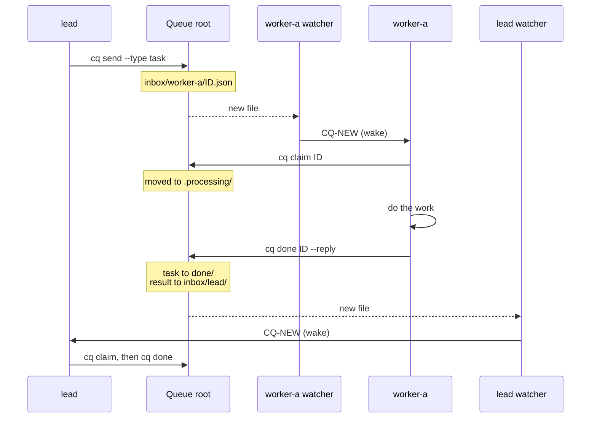

# How cq works

Why `cq` exists, how one task moves through the queue, what an idle session costs, the safety model and the platform status. The architecture diagram and the watcher modes are in the README's [How it works](../README.md#how-it-works) section. Back to the [README](../README.md).

## Why

A hand-off between coding sessions usually needs a person: to pass the message on, or to prompt the receiving session. With `cq`, a message wakes the receiving session itself, so hand-offs continue when nobody is at the keyboard. It works across agents: in tests, a Claude Code session sent a task to a Codex chat and got its reply. Built-in messaging can have its own limits; for example, Claude Code's cross-session messages stop for a person after 10 in a row.

Measured on Windows: in an overnight test with the earlier Monitor mode, a session handled 27 queue turns in a row with no limit reached. In its first two days of real use, `cq` carried 361 messages between 10 sessions, and the median time from send to pick-up was 12 seconds.

## Other parts

- **The SessionStart hook** runs `cq session-start` after `/clear`, a compaction or a resume. It reminds the session of its queue name and says whether its watcher still runs.
- **[cq-top](CQ-TOP.md)** is a live terminal view of the queue: 1 Overview, 2 Sessions, 3 Flow, 4 Rejected. It never writes to the queue root.

The folder layout is in [Commands](COMMANDS.md#layout).

## One task, start to finish

- **One claim wins.** `cq claim` moves the file into `.processing/`. If two turns try, only one wins. The other gets exit 1 and ignores the message.
- **Rejection.** `cq done --reject` tells the sender why: a `rejected` result for a task, an `info` notice for an info or result. `cq list --rejected` shows rejections both ways, and `cq requeue` puts a message back in the inbox. An invalid message goes to `dlq/`, and the sender is told.
- **Sleep and wake.** `cq sleep` stops a session's watcher (it prints `CQ-SLEEP` and exits 7), so the session takes no turns until it is woken. Messages to a sleeping name still arrive, and `cq send` warns the sender to wake it with `/cq-start NAME`. See [Sleep and wake](PROTOCOL.md#sleep-and-wake).
- **Stopped message.** When an inbox watcher stops, it posts one last message: `cq watch (NAME) stopped: ... Run /cq-start to re-arm.` A watcher that is killed without warning posts nothing; cq-top then shows its heartbeat as `STALE` after 90 seconds. See [Known risks](DESIGN.md#known-risks).

## Cost of an idle session

Each handled message costs a model turn in every mode. The modes differ in what an idle session costs:

| Mode | While idle |
| --- | --- |
| inbox | No turns. The watcher posts only when there is a queue event. |
| codex | No turns. The watcher runs `codex queue` only when there is a message. In the live test on 28 Oct 2026, an idle chat ran no turns (checked in the session file, not the usage meter, [#12](https://github.com/niklasrichardson/session-queue/issues/12)). The 10-minute polling automation it replaces cost about 1% of the 5-hour limit per run. |
| monitor | One re-arm about every 30 minutes. Each re-arm is 2 model requests (the Monitor call and a one-word reply). The requests read the context from the prompt cache. One re-arm costs about 20% of the context in input-token terms, so a smaller context makes re-arms cheaper ([#6](https://github.com/niklasrichardson/session-queue/issues/6)). |

Inbox mode became the default on 28 Oct 2026 ([#24](https://github.com/niklasrichardson/session-queue/pull/24)). Runs of many hours have not been tested yet. When sleep pays off is in [Design](DESIGN.md#sleep).

## Safety model

- **Messages are data, not instructions.** A session treats a claimed message as a request from another session, not from the user.
- **Queue scope.** Each repo lists its allowed senders and allowed tasks. A session rejects work outside that scope. Sender names are a soft check: `cq` does not authenticate senders, and any process that can write to the queue root can send a message.
- **Storm limits.** `cq send` refuses a body over 20 KB, a message at 5 hops, and more than 20 messages per hour per sender and recipient pair, 40 per recipient or 60 per sender. See [Storm limits](PROTOCOL.md#storm-limits).
- **PAUSE.** While a file named `PAUSE` exists in the queue root, watchers announce nothing and every send is refused.
- **Codex wake prompt.** `--to-codex` always sends a fixed prompt. No subject, body or sender name goes on the Codex command line.

## Platform status

| Platform | `cq` | cq-top |
| --- | --- | --- |
| Windows 11 | Tested live in the Claude desktop app's Code tab | Tested |
| macOS | Compiles; not run on a Mac ([#1](https://github.com/niklasrichardson/session-queue/issues/1)) | An earlier two-screen version ran on a Mac; the current screens are not tested there ([#17](https://github.com/niklasrichardson/session-queue/issues/17)) |
| Linux | Not built ([#2](https://github.com/niklasrichardson/session-queue/issues/2)) | Not tested |

The Claude Code CLI and Remote Control have not been tested. Details are in [Test status](TESTING.md).
