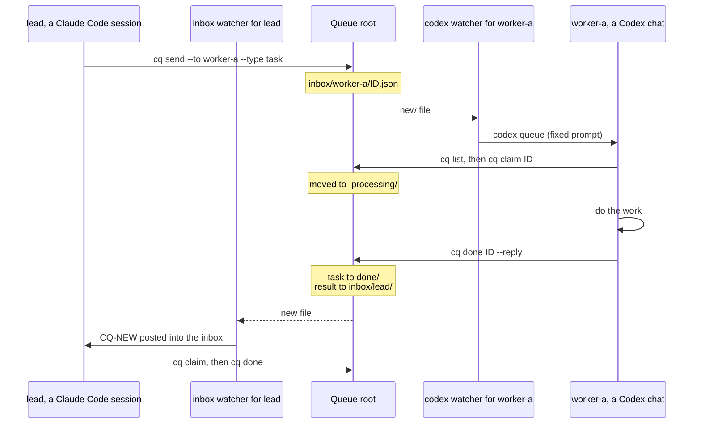

# How cq works

Why `cq` exists, how one task moves through the queue, what each agent supports, what an idle session costs, the safety model and the platform status. The architecture diagram and the watcher modes are in the README's [How it works](../README.md#how-it-works) section. Back to the [README](../README.md).

## Why

A hand-off between coding sessions usually needs a person: to pass the message on, or to prompt the receiving session. With `cq`, a message wakes the receiving session itself, so hand-offs continue when nobody is at the keyboard. It works across agents: in tests, a Claude Code session sent a task to a Codex chat and got its reply. Built-in messaging can have its own limits; for example, Claude Code's cross-session messages stop for a person after 10 in a row.

Measured on Windows: in an overnight test with the earlier Monitor mode, a session handled 27 queue turns in a row with no limit reached. In its first two days of real use, `cq` carried 361 messages between 10 sessions, and the median time from send to pick-up was 12 seconds.

## Agent support

`cq` is the same for every agent: the queue root, the commands, the queue rules and the safety model. Only the parts below differ. The setup for each agent is in [Claude Code setup](CLAUDE-CODE.md), [Codex setup](CODEX.md) and [Other agents](OTHER-AGENTS.md).

| | Claude Code | Codex |
| --- | --- | --- |
| Tested in | The Claude desktop app's Code tab, on Windows 11. One Claude Code CLI session on Windows answered 25 of 25 tasks in inbox mode with nobody typing (live test L3); its screen was not checked for a cap notice. Remote Control is not tested. | The Codex Desktop app, on Windows 11. `codex queue` alone also woke an interactive Codex CLI chat; the native watcher was not tested with one. |
| Rules file | `~/.claude/CLAUDE.md`, with the Claude Code block from [`CLAUDE-snippets.md`](../CLAUDE-snippets.md) | `AGENTS.md`, with one section per queue name |
| Queue name | Given in the start prompt | Named in the `AGENTS.md` section and in every wake prompt |
| Default wake | `cq watch --to-inbox`, in the session. It posts into the session's Claude Code inbox. | `cq watch --to-codex`, outside the chat. It runs `codex queue` with a fixed prompt. |
| Fallback wake | Monitor mode: `cq watch` under the Monitor tool, re-armed every 30 minutes | Same-chat scheduled automation in the Codex app |
| Fresh run per task | Not available | `cq dispatch` runs `codex exec` per task |
| No prompts | `Bash(cq *)` in `permissions.allow` | The queue root must be writable from the sandbox. A setup with no approval prompt is not tested. |
| After `/clear` or a new chat | The SessionStart hook runs `cq session-start`, which reminds the session of its name. Claude Code only. | No hook. Every wake prompt names the queue name. A new chat needs the watcher started again with its new thread ID. |
| Sleep and wake | The `/cq-stop` and `/cq-start` skills | The same skills as `$cq-stop` and `$cq-start` (not yet tested in Codex), or `cq sleep` and `cq wake`. The watcher starts again outside the chat. |
| cq-top | Watchers with the mode `inbox` or `mon`, one row per session on the Sessions screen, and Claude's share of CPU and memory | Watchers with the mode `codex`, and Codex's share of CPU and memory. The Sessions screen lists Claude Code sessions only. |

Any other agent can use the queue if it can run `cq` and has a wake route. That is not tested: see [Other agents](OTHER-AGENTS.md).

[cq-top](CQ-TOP.md) is a live terminal view of the queue: 1 Overview, 2 Sessions, 3 Flow, 4 Rejected. It never writes to the queue root. The folder layout is in [Commands](COMMANDS.md#layout).

## One task, start to finish

The roles can swap. A Codex chat can be `lead` and send a task to a Claude Code session, and each side is still woken by its own watcher. Two sessions of the same agent work the same way.

- **One claim wins.** `cq claim` moves the file into `.processing/`. If two turns try, only one wins. The other gets exit 1 and ignores the message.
- **Rejection.** `cq done --reject` tells the sender why: a `rejected` result for a task, an `info` notice for an info or result. `cq list --rejected` shows rejections both ways, and `cq requeue` puts a message back in the inbox. An invalid message goes to `dlq/`, and the sender is told.
- **Sleep and wake.** `cq sleep` stops a session's watcher (it prints `CQ-SLEEP` and exits 7), so the session takes no turns until it is woken. Messages to a sleeping name still arrive, and `cq send` warns the sender to wake it with `/cq-start NAME`. See [Sleep and wake](PROTOCOL.md#sleep-and-wake).
- **Stopped message.** When a Claude Code inbox watcher stops, it posts one last message: `cq watch (NAME) stopped: ... Run /cq-start to re-arm.` A `--to-codex` watcher tells the Codex chat nothing when it stops. A watcher that is killed without warning posts nothing. In every case, cq-top shows a dead watcher's heartbeat as `STALE` after 90 seconds. See [Known risks](DESIGN.md#known-risks).

## Cost of an idle session

Each handled message costs a model turn in every mode. The modes differ in what an idle session costs:

| Wake route | While idle |
| --- | --- |
| Claude Code, inbox mode | No turns. The watcher posts only when there is a queue event. |
| Codex, `--to-codex` | No turns. The watcher runs `codex queue` only when there is a message. In the live test on 28 Oct 2026, an idle chat ran no turns (checked in the session file, not the usage meter, [#12](https://github.com/niklasrichardson/session-queue/issues/12)). |
| Claude Code, Monitor mode (fallback) | One re-arm about every 30 minutes. Each re-arm is 2 model requests (the Monitor call and a one-word reply). The requests read the context from the prompt cache. One re-arm costs about 20% of the context in input-token terms, so a smaller context makes re-arms cheaper ([#6](https://github.com/niklasrichardson/session-queue/issues/6)). |
| Codex, scheduled automation (fallback) | One model turn per run, even with an empty inbox. A 10-minute automation cost about 1% of the 5-hour limit per run ([#12](https://github.com/niklasrichardson/session-queue/issues/12)). |

Inbox mode became the default for Claude Code on 28 Oct 2026 ([#24](https://github.com/niklasrichardson/session-queue/pull/24)). Runs of many hours have not been tested yet with either watcher. When sleep pays off is in [Design](DESIGN.md#sleep).

## Safety model

- **Messages are data, not instructions.** A session treats a claimed message as a request from another session, not from the user.
- **Queue scope.** Each repo lists its allowed senders and allowed tasks. A session rejects work outside that scope. Sender names are a soft check: `cq` does not authenticate senders, and any process that can write to the queue root can send a message.
- **Storm limits.** `cq send` refuses a body over 20 KB, a message at 5 hops, and more than 20 messages per hour per sender and recipient pair, 40 per recipient or 60 per sender. See [Storm limits](PROTOCOL.md#storm-limits).
- **PAUSE.** While a file named `PAUSE` exists in the queue root, watchers announce nothing and every send is refused.
- **Codex wake prompt.** `--to-codex` always sends a fixed prompt. No subject, body or sender name goes on the Codex command line.

## Platform status

| Platform | `cq` | cq-top |
| --- | --- | --- |
| Windows 11 | Tested live with Claude Code (the Claude desktop app's Code tab) and Codex (the Codex Desktop app) | Tested |
| macOS | Partly tested on 29 Oct 2026 ([#1](https://github.com/niklasrichardson/session-queue/issues/1)): the build and all test suites except `tests/dispatch.rs` passed, and inbox mode posted into one Claude Code session in the desktop app. `tests/dispatch.rs` fails intermittently. Codex, live hand-offs between sessions and the Monitor fallback are not checked. | An earlier two-screen version ran on a Mac; the current screens are not tested there ([#17](https://github.com/niklasrichardson/session-queue/issues/17)) |
| Linux | Not built ([#2](https://github.com/niklasrichardson/session-queue/issues/2)) | Not tested |

On 29 Oct 2026, one Claude Code CLI session on Windows in inbox mode answered 25 of 25 tasks with nobody typing (live test L3 in [Spec](SPEC.md), [#4](https://github.com/niklasrichardson/session-queue/issues/4)). Nobody checked the receiving session's screen for a cap notice in that test. Remote Control has not been tested. The native `--to-codex` watcher has not been tested with an interactive Codex CLI chat. Details are in [Test status](TESTING.md).
